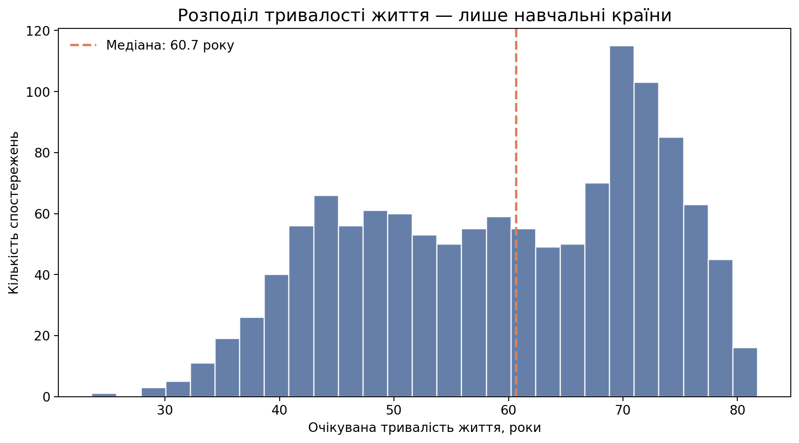
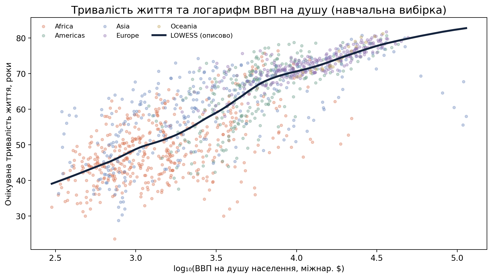
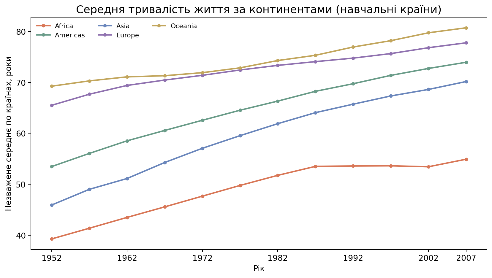
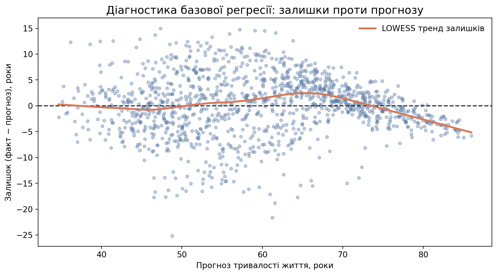
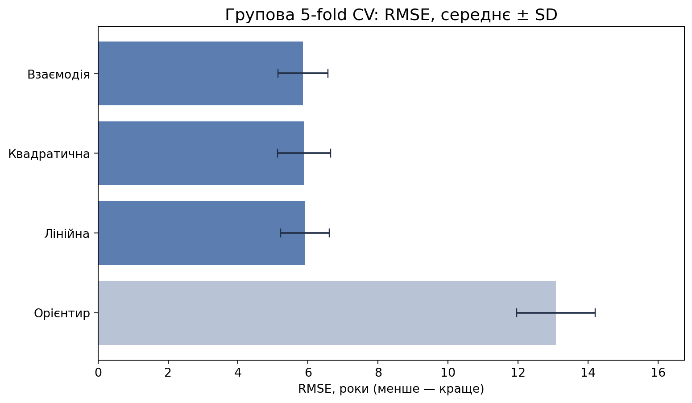
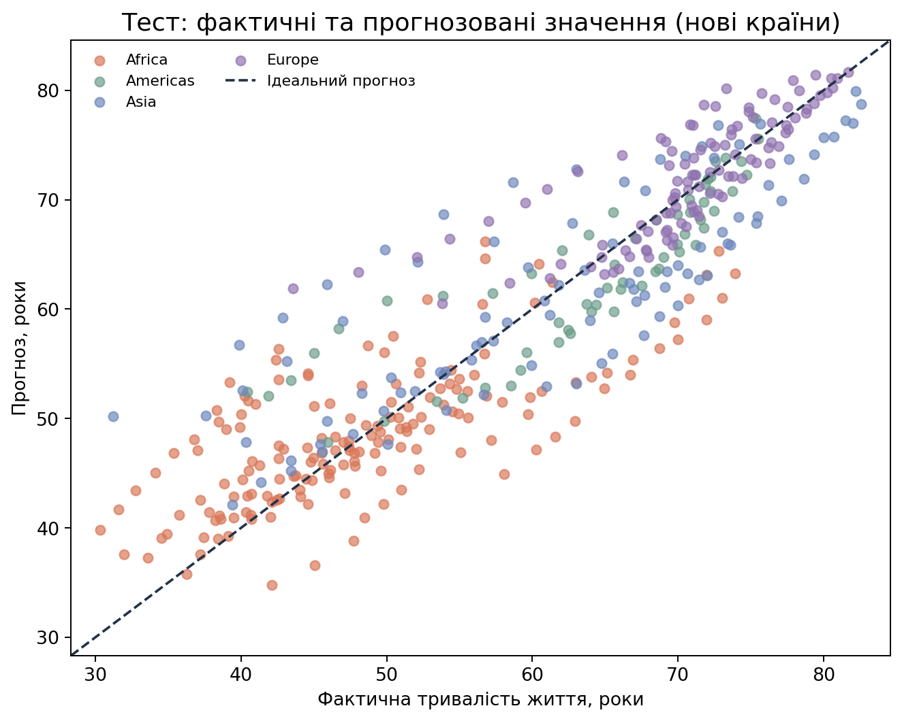
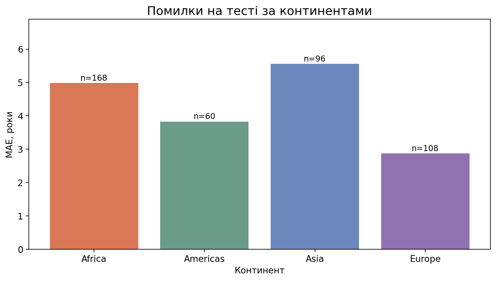

```{python}
#| label: run-all
#| include: false
# Головний відтворюваний крок: перерахувати всі метрики й PNG,
# не підглядаючи у відкладений тест до вибору моделі.
from src.analysis import run_analysis
results = run_analysis(quiet=True)
assert results['metadata']['n_test'] == 432
```

## 1. Вступ

**Предметна область.** Міжнародне здоров’я населення та його статистичні асоціації з економічним добробутом. Використано історичний Gapminder: **1 704 записи** для **142 країн** за **12 років спостереження (1952–2007)**. Одиниця спостереження — **країна в конкретному році**, а не людина. Ціль `lifeExp` — **очікувана тривалість життя при народженні, роки**.

**Головне дослідницьке питання:** наскільки точно можна прогнозувати `lifeExp` для **нових країн** (відсутніх у навчанні), якщо відомі ВВП на душу населення, календарний рік і континент, у межах історичного періоду 1952–2007?

Вхідні чинники: `gdpPercap` (ВВП на душу населення, міжнародні долари), `year` і `continent`. Країна `country` використовується **лише для групового розбиття**; `pop` та ISO-коди не включаються до регресорів. Всі предиктори описують той самий країна-рік; для майбутнього невідомого року ВВП також потрібно спершу оцінити, тому ця робота **не є прогнозом майбутніх років**.

### 1.1. Предметна література

- **Preston (1975)** описав зв’язок між рівнем економічного розвитку та смертністю, з можливістю змін зв’язку в історичному часі. Звідси випливають включення доходу і року до моделі, обережність із припущенням прямої лінійності та заборона трактувати асоціацію як причинний ефект. [DOI: 10.1080/00324728.1975.10410201](https://doi.org/10.1080/00324728.1975.10410201).
- **Pritchett і Summers (1996)** досліджували співвідношення доходів і показників здоров’я на міжнародних панельних даних. Джерело підтримує включення доходу, але його власні методи ідентифікації не можна переносити на просту OLS-оцінку: наші коефіцієнти — **асоціації, не причинні наслідки**. [DOI: 10.2307/146149](https://doi.org/10.2307/146149).

### 1.2. Гіпотези, сформульовані до оцінювання моделей

**H1 (розвідувальна після ЕDA №2).** За однакового року та континенту `log10(gdpPercap)` позитивно асоційований із `lifeExp`. Перевірка: знак коефіцієнта при `log10_gdp` та **95% кластерний за країною ДІ** в **заздалегідь заданій базовій лінійній моделі**. Логарифм доходу обрано через широкий діапазон ВВП й результати №2; у випробуванні також є квадратичний член і взаємодія з континентом.

**H2 (розвідувальна після ЕDA №2).** За однакового логарифма доходу та континенту пізніший календарний рік позитивно асоційований з `lifeExp`. Перевірка: знак, розмір та 95% кластерний ДІ коефіцієнта `year_5 = (year - 1952)/5` у тій самій базовій моделі.

> **Примітка про незалежність:** лабораторна №2 вже містила EDA **всього** Gapminder, включно з країнами, які зараз будуть тестовими. Тому гіпотези й остаточна перевірка не є повністю незалежним підтвердженням у науковому сенсі. Результати трактуємо як **розвідувальні**. У №3 жодна тестова ціль не застосовувалася для підбору моделі.

## 2. Методи

### 2.1. Дані, якість, доступ і ліцензія

Джерело — [Gapminder](https://www.gapminder.org/data/) та історичний екстракт, розповсюджуваний у [CRAN `gapminder`](https://cran.r-project.org/package=gapminder) (ліцензія **CC0** для цього екстракту). **Локальна копія використана та відтворена з `plotly.express.data.gapminder()` (Plotly 6.5.2)**, збережена у `data/raw/gapminder.csv` у цьому репозиторії; набір і код працюють без інтернету. Файл зафіксовано 18.11.2026, SHA-256 указаний у `outputs/metadata/run_info.json`. Усі 1704 записи мають необхідні поля: **0 пропусків, 0 дублікатів країна-рік**, додатні `gdpPercap`, `lifeExp` і `pop`. Видаляти історичні екстремальні значення без документального підтвердження помилок недоцільно.

### 2.2. Навчальне EDA

Спочатку виконано **один фіксований груповий поділ** `GroupShuffleSplit(test_size=0.25, random_state=42)` за країною: **1272 країна-років з 106 країн — навчання; 432 країна-роки з 36 інших країн — тест**. Наступні EDA-рисунки побудовані **тільки на навчанні**.



Медіана `lifeExp` у навчанні — **60,65 року**; мінімум — **23,60**, максимум — **81,76**. Розкид значний, константний прогноз повинен бути слабким орієнтиром.



Кореляція Пірсона між `lifeExp` та `log10(gdpPercap)` у навчанні — **r = 0,803** (описова, без причинної інтерпретації). Через широке охоплення доходів застосовано `log10_gdp`; у кандидатах є квадрат цього показника й взаємодія з континентом.



Це **не середні показники людей у світі**, адже кожна країна має однакову вагу незалежно від населення. У панелі повторюються країни, тож випадкове розбиття рядків дало б витік інформації між роками тієї самої країни.

### 2.3. Протокол, зафіксований до тесту

**Прогнозне завдання:** передбачити історичні країна-рік для **країн, яких немає в навчанні** (не часовий прогноз). Для всіх моделей — **однакові п’ять групових фолдів** `GroupKFold(5)` по країнах усередині навчальної частини; у кожному фолді країни в навчанні та валідації **не перетинаються**. Моделі навчаються заново на навчальних країнах фолду.

**Первинна метрика — RMSE (роки)**, оскільки великі похибки є особливо небажаними; допоміжна — **MAE (роки)** для типової абсолютної помилки. У таблиці середнє ± стандартне відхилення **п’яти fold-метрик**, не довірчі інтервали. Переможець — регресійна модель з найменшим середнім CV RMSE; тест використовується **один раз після фіксації вибору**. Константний орієнтир — середнє `lifeExp` **лише відповідного навчального фолду**.

**Передобробка:** `log10(gdpPercap)` і `year_5` — наперед задані детерміновані перетворення. Пропусків немає, отже імпутація не потрібна. Масштабування, відбір ознак та пошук гіперпараметрів не проводилися; категоріальні рівні під час OLS-кодування формуються **лише з навчальних даних кожного фолду**. Усі континенти представлені в навчанні та валідації. Жодна підгонка на тестовій частині не виконується.

## 3. Результати

### 3.1. Оцінені моделі

Моделі визначені до порівняння:

1. **Орієнтир:** `ŷ = середнє lifeExp у навчанні`.
2. **Базова OLS:** `lifeExp ~ log10_gdp + year_5 + C(continent)`.
3. **Квадратична OLS:** базова + `I(log10_gdp ** 2)`; перевіряє кривизну залежності від доходу.
4. **OLS із взаємодією:** `lifeExp ~ log10_gdp * C(continent) + year_5`; перевіряє різні нахили зв’язку доходу на різних континентах.

Усі формули реалізовані в `src/analysis.py` через `statsmodels`. Код доступний та перевіряється також у `notebooks/Regression.ipynb`.

### 3.2. Коефіцієнти та гіпотези

Для **заздалегідь визначеної базової моделі** (навчальна частина, **кластерно-стійкі стандартні похибки за країною**) отримано:

| Предиктор | Оцінка | 95% ДІ | Інтерпретація |
|:--|--:|:--|:--|
| `log10_gdp` | **+11,22** | **[8,66; 13,77]** | При ×10 вищому ВВП на душу прогноз `lifeExp` більший на 11,22 року, за фіксованих року і континенту |
| `year_5` | **+1,21** | **[1,02; 1,40]** | Кожні додаткові 5 календарних років відповідають у середньому +1,21 року lifeExp за однакового доходу та континенту |

Базова регресія на навчанні: $R^2 = 0{,}799$. **H1 та H2 підтримані за напрямом і 95% ДІ**, які не перетинають нуль. Проте це статистичні асоціації, а не докази, що збільшення доходу або сам перебіг часу *спричиняють* саме такі зміни здоров’я. Реальні фактори системи охорони здоров’я, освіти, воєн, інфраструктури та інші не виміряні.

### 3.3. Діагностика базової OLS



Тест Бройша—Пагана на навчанні дав **p = 2,28 × 10⁻¹⁴**, що свідчить про неоднорідну дисперсію залишків за умов цієї моделі. Діагностика відстані Кука: **59 із 1272** спостережень понад орієнтовний поріг **4/n = 0,00314**; максимальна відстань Кука **0,02265**. Їх **не видаляли автоматично**, оскільки це реальні історичні країна-роки. Для висновків про коефіцієнти застосовано кластерно-стійкі ДІ; така корекція не усуває зміщення моделі та не гарантує стабільність прогнозу на незнайомих країнах.

### 3.4. Порівняння моделей: 5-fold CV за країнами

| Модель | MAE середнє ± SD, роки | RMSE середнє ± SD, роки |
|:--|--:|--:|
| Константний орієнтир | 11,455 ± 1,142 | 13,082 ± 1,118 |
| Лінійна OLS | 4,577 ± 0,465 | 5,911 ± 0,698 |
| Квадратична OLS | 4,527 ± 0,452 | 5,885 ± 0,760 |
| **OLS із взаємодією** | **4,443 ± 0,523** | **5,856 ± 0,717** |



**Вибір, зроблений до тесту:** OLS із взаємодією `log10_gdp × continent` має найменший середній RMSE = **5,856 року**. Виграш проти простої OLS невеликий (**0,055 року**), менший за варіацію між фолдами; тому **перевага є числовою, а не переконливою статистичною**. Але за зафіксованим правилом обираємо взаємодію. Модель перенавчена на всіх 1272 навчальних рядках.

### 3.5. Одноразова фінальна оцінка на 36 нових країнах

| Модель | Тестова MAE, роки | Тестова RMSE, роки |
|:--|--:|--:|
| Константний орієнтир | 11,620 | 13,178 |
| **Обрана OLS з взаємодією** | **4,424** | **5,972** |





Найбільші абсолютні помилки у відкладеній частині спостерігаються, зокрема, для **Камбоджі (1977: похибка ≈ −18,99 року)**, **Туреччини (1952: ≈ −18,31)** та **Саудівської Аравії (1952: ≈ −16,87)**. Модель переоцінює тривалість життя цих спостережень; це не обов’язково помилки даних — можуть бути важливі чинники, відсутні в регресії. Докладна таблиця — `outputs/tables/test_worst_errors.csv`.

## 4. Обговорення та висновки

**Відповідь на питання.** Для нових країн у історичному часовому вікні за наявних показників доходу, року й континенту регресія з взаємодією досягає на тесті **MAE ≈ 4,42 року**, **RMSE ≈ 5,97 року**, суттєво краще, ніж константний прогноз (**RMSE ≈ 13,18**). Це показує **помітну прогнозну інформацію** в обраних ознаках, але типова похибка у кілька років і великі залишкові помилки для окремих історичних спостережень обмежують застосування.

**H1:** позитивна умовна асоціація логарифма ВВП з `lifeExp` є стійкою за знаком у базовій OLS (95% кластерний ДІ **[8,66; 13,77]** року на десятикратне збільшення доходу). **H2:** оцінений умовний зв’язок року позитивний (**[1,02; 1,40]** року lifeExp на п’ятирічний крок). Обидві гіпотези **розвідувальні**, оскільки сформульовані після EDA цього набору.

**Обмеження:** панельні історичні макродані не встановлюють причинність; простий рік змішує історичні процеси; дані не містять доступності лікування, конфліктів, освіти, вікової структури; країни за межами набору можуть мати інші закономірності. Вибірка не включає пізніші за 2007 рік періоди, а тому модель **не перевірена для 2026 року**. Хоча груповий тест відокремлює країни, EDA у №2 вже містив цей датасет цілком, тому повністю незалежна верифікація потребує нової вибірки.

**Конкретне продовження:** отримати новий, не використаний раніше набір **країна-рік після 2007 року** з порівнюваними одиницями доходу й цілі, зафіксувати поточну модель і протестувати її **без переналаштування**, порівнявши похибки та калібрування за континентами.

## Бібліографія

1. Preston, S. H. (1975). *The Changing Relation between Mortality and Level of Economic Development*. Population Studies, 29(2), 231–248. https://doi.org/10.1080/00324728.1975.10410201
2. Pritchett, L., & Summers, L. H. (1996). *Wealthier Is Healthier*. Journal of Human Resources, 31(4), 841–868. https://doi.org/10.2307/146149
3. Gapminder Foundation. *Data*. https://www.gapminder.org/data/
4. Bryan, J. (2025). *gapminder: Data from Gapminder* (CRAN package, version 1.0.1, CC0). https://doi.org/10.32614/CRAN.package.gapminder
5. James, G., Witten, D., Hastie, T., & Tibshirani, R. et al. *An Introduction to Statistical Learning*. https://www.statlearning.com/
6. NIST/SEMATECH. *How can I tell if a model fits my data?* https://www.itl.nist.gov/div898/handbook/pmd/section4/pmd44.htm
7. Quarto. *Using Python*. https://quarto.org/docs/computations/python
8. DataCamp. *OLS Regression; Simple Linear Regression; Linear Regression in R; Multiple Linear Regression in R* (навчальні матеріали, посилання в README).

## Додаток. Реплікація

Корінь репозиторію містить виконуваний notebook `notebooks/Regression.ipynb`, `src/analysis.py`, вихідні дані `data/raw/gapminder.csv`, CSV-таблиці, PNG-графіки, презентацію та текст захисту. Команди:

```powershell
py -m venv .venv
.\.venv\Scripts\python.exe -m pip install -r requirements.txt
.\.venv\Scripts\python.exe -m src.analysis
quarto render reports/report.qmd --to html
```

**Схема без витоку:** країни тесту не використовувалися ні у тренуванні, ні у п’яти фолдах CV, ні в EDA №3; **попередня глобальна EDA №2** явно зазначена як обмеження незалежності інтерпретації.
